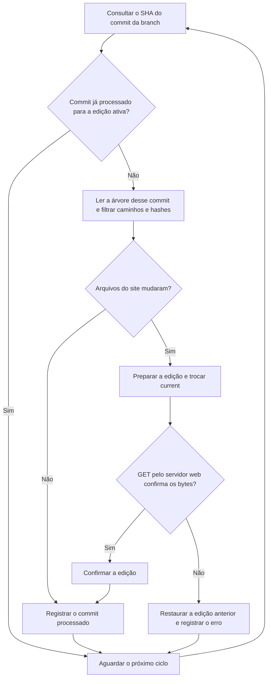
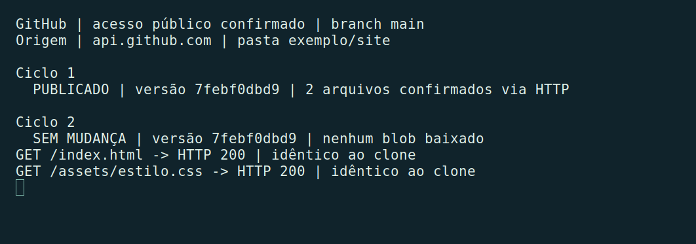

# Publicador estático

Uma VPS acompanha uma pasta de um repositório no GitHub, publica os arquivos quando o conteúdo muda e confirma por HTTP o que um visitante recebe.

## Caso de uso

Quem hospeda um site de terceiros pode ter autorização para ler e republicar os arquivos, enquanto a administração do repositório fica com outra equipe. Nesse cenário, configurar GitHub Actions ou webhooks na origem depende de quem a mantém. Conferir a branch e copiar os arquivos manualmente pode deixar uma atualização passar. Durante a cópia, um visitante também pode receber arquivos de duas edições diferentes.

O operador escolhe a pasta publicável, e a VPS inicia todas as consultas. Quando a branch permanece no mesmo commit já processado, uma consulta ao GitHub encerra o ciclo. A árvore e os arquivos só são examinados se necessário. O repositório inclui um boletim em HTML e CSS para experimentar o fluxo completo.

## Como funciona



A API da branch fornece o SHA do commit e o identificador da árvore correspondente na mesma resposta. O publicador compara o commit com o último processado para aquela origem, branch, pasta e edição ativa. Se for o mesmo, a próxima consulta fica para depois do intervalo de polling.

Ao encontrar um commit novo, o Python pede a árvore pelo identificador recebido e filtra os arquivos da pasta publicável. A lista ordenada de caminhos e hashes define a edição do site. Se só o README mudou, o programa registra o novo commit e mantém a edição anterior, sem baixar os arquivos. Um deploy que falha fica pendente para nova tentativa.

Os downloads usam os hashes da árvore consultada. Assim, mesmo que a branch avance durante a cópia, os arquivos pertencem à mesma fotografia da origem. O publicador monta a pasta inteira antes de trocar `current`, a raiz do servidor web. Depois da troca, faz um GET de cada arquivo e compara seu conteúdo com o hash de origem. Se a leitura falhar, restaura o apontamento anterior. Na primeira publicação, a confirmação bem-sucedida estabelece a primeira versão recuperável.

## Tecnologias e integrações

| Componente | Papel |
| --- | --- |
| Python 3.10+ em Linux | `urllib` faz as requisições, `json` interpreta a árvore, `hashlib` verifica os conteúdos e `fcntl` impede ciclos simultâneos. |
| API REST do GitHub por HTTPS | Lê o commit da branch, a árvore imutável e os blobs necessários. Um token Bearer pode conceder leitura de conteúdo. [Branches](https://docs.github.com/en/rest/branches/branches#get-a-branch) · [Git Trees](https://docs.github.com/en/rest/git/trees#get-a-tree) · [Git Blobs](https://docs.github.com/en/rest/git/blobs#get-a-blob) |
| Servidor HTTP da VPS | Serve a pasta ativa e responde à verificação independente do publicador. O exemplo de operação usa o Caddy. [Caddy file_server](https://caddyserver.com/docs/caddyfile/directives/file_server) |
| systemd | Mantém o processo de polling ativo na VPS e direciona a saída para o journal. |

## Instalação e uso

Use Linux, Git e Python 3.10 ou superior. A biblioteca padrão cobre todas as dependências.

```bash
git clone https://github.com/iagobg/publicador-estatico.git
cd publicador-estatico
```

**Demonstração em um terminal, inclusive sem internet após o clone**

```bash
python3 demo.py --manter
```

Abra no navegador o endereço de loopback que o programa imprimir. Ele escolhe portas livres, cria uma área temporária e executa cinco ciclos com o mesmo publicador usado na VPS. A origem é uma simulação local da API com um token gerado em memória. O servidor de arquivos atende requisições HTTP reais. Pressione Enter no final para liberar as portas.

**Executar com a API real do GitHub**

1. Copie o modelo e restrinja a leitura antes de preencher uma credencial.

   ```bash
   cp .env.example .env
   chmod 600 .env
   ```

2. Edite `.env`. Para publicar o boletim deste repositório, use `GITHUB_REPO=iagobg/publicador-estatico`, `GITHUB_BRANCH=main` e `SOURCE_DIR=exemplo/site`. Os demais valores do modelo atendem ao teste local. Para uma origem própria, escolha uma pasta dedicada a conteúdo pronto para publicação. Use `.` se toda a raiz tiver essa finalidade.

   | Variável | Significado |
   | --- | --- |
   | `GITHUB_REPO`, `GITHUB_BRANCH` | Repositório no formato `conta/nome` e branch consultada. |
   | `SOURCE_DIR` | Pasta de origem que contém o `index.html`. |
   | `GITHUB_TOKEN` | Opcional para conteúdo público. Para uma origem privada, use um token de acesso restrito ao repositório, com `Contents: Read-only`. O publicador envia o token à API de origem. |
   | `DEPLOY_DIR` | Diretório exclusivo do publicador para versões, links e trava. |
   | `SITE_URL` | URL que o servidor web associa a `DEPLOY_DIR/current`. |
   | `POLL_SECONDS` | Tempo de espera entre o término de um ciclo e o início do próximo. O exemplo usa 120 segundos. |

3. Em um terminal, na raiz do clone, inicie o servidor de arquivos de laboratório. A página ficará disponível após o primeiro deploy.

   ```bash
   python3 -m http.server 8080 --bind 127.0.0.1 --directory estado/current
   ```

4. Em outro terminal, no mesmo clone, carregue as variáveis e inicie o polling.

   ```bash
   set -a
   . ./.env
   set +a
   python3 publicador.py
   ```

   Abra [o boletim local](http://127.0.0.1:8080/) depois de aparecer `PUBLICADO`. Para rodar um único ciclo, use `python3 publicador.py --uma-vez`. Nesse modo, o código de saída é 0 para sucesso, 1 para falha de execução e 2 para erro de configuração.

Para instalação persistente, siga o procedimento com usuário de serviço, raiz HTTP e consulta de logs. [Operação na VPS](operacao/README.md)

**Escopo da publicação.** O site precisa conter um `index.html` na pasta selecionada. O filtro aceita arquivos web estáticos, ignora nomes ocultos, links simbólicos e submódulos, e rejeita árvores truncadas. Os limites por edição são 100 arquivos, 4 MiB por arquivo e 32 MiB no total. Publique apenas conteúdo cuja redistribuição esteja autorizada. O HTML e o JavaScript são entregues ao navegador como vieram da origem.

<a id="5-demonstração-e-resultados"></a>

## Exemplos de execução

**Com a API real do GitHub.** A partir de um clone novo, o publicador consultou a branch pública e ativou o boletim. Um cliente HTTP leu o HTML e o CSS do servidor local e comparou os bytes com os arquivos do clone. O segundo ciclo reconheceu o SHA já processado e dispensou a consulta à árvore.



**Falha e recuperação reproduzíveis.**
Captura de uma execução de `python3 demo.py --intervalo 1`. O segundo ciclo dispensou a árvore. No terceiro, um commit só de documentação manteve a edição 1. Na quarta consulta, a origem devolveu HTTP 503. Logo abaixo, o GET feito como visitante retornou HTTP 200 com a edição 1. A última consulta publicou a edição 2 e verificou os dois arquivos pelo servidor.


Os testes cobrem SHA repetido, commit documental, migração de estado, mudança de pasta, avanço da branch durante o download, autenticação, filtragem, concorrência e recuperação de falhas.

```bash
python3 -m unittest discover -s tests -v
```

## Melhorias futuras

- Usar consultas condicionais com ETag para reduzir também a transferência de metadados da branch.
- Respeitar o tempo de espera indicado pela API quando a cota de consultas se esgotar.
- Validar referências locais de HTML e CSS antes da troca, para identificar recursos que o autor esqueceu de incluir.
